# JUH — 가벼운 통합 성능 모니터링(APM)
> 요청부터 SQL, 서버 리소스, 부하테스트까지. 여러 화면을 오가는 수고를 줄이고, 성능 문제를 한곳에서 확인해 보세요.

### 모니터링하고 부하테스트하려고, 도대체 몇 개를 더 설치해야 하나요?

서버 지표를 수집하려고 Prometheus를 추가하고, 그래프를 보려고 Grafana를 연결하고, 요청 흐름을 추적하려고 Zipkin을 설정하고, 느린 SQL을 찾으려고 또 다른 도구를 붙이고, 부하테스트 결과를 확인하려고 별도 도구까지 실행하고…

### 모니터링 좀 해보려다가 설정만 하다 하루가 다 가셨나요?

## 이제 그만 추가하세요. JUH 하나면 됩니다. 무료

**JUH는 요청 추적, 서버 리소스, SQL 통계, 부하테스트 결과를 하나의 대시보드에서 확인할 수 있도록 통합한 가벼운 Spring Boot APM입니다.**

<p align="center">
  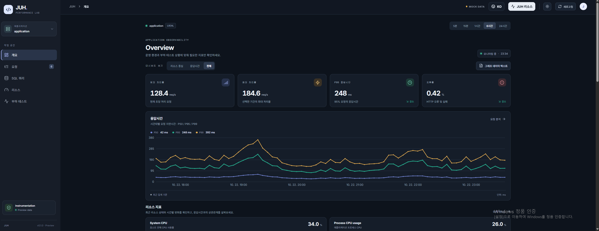
</p>

<p align="center">
  <strong>의존성 하나로 시작하는 통합 성능 모니터링.</strong>
</p>

- **대시보드 미리보기:** https://unique-lollipop-9a4948.netlify.app
- **현재 최신 버전:** `0.2.2`

Gradle 의존성:

```groovy
implementation 'io.github.gangjonggeun:juh-spring-boot-starter:0.2.2'
```
```kotlin dsl
implementation (io.github.gangjonggeun:juh-spring-boot-starter:0.2.2)
```
> **💡 대시보드 접속**
>
> 브라우저에서 애플리케이션 주소 뒤에 `/juh` 또는 `/juh/`를 붙여 접속할 수 있습니다.
>
> - 예시 (로컬): `http://localhost:8080/juh` or `http://localhost:8080/juh/`
> - 예시 (배포 환경): `https://example.com/juh` or `https://example.com/juh/`

물론 Prometheus, Grafana, Zipkin은 각각 훌륭한 도구입니다. 다만 여러 도구를 연결하고 화면을 오가며 확인하는 과정이 번거로워, 주요 성능 정보를 한곳에서 살펴볼 수 있도록 JUH를 만들었습니다.

---


## 주요 기능

| 기능 | 확인할 수 있는 정보 |
|---|---|
| 통합 대시보드 | 현재 처리율(RPS), 최대 처리율, P95 응답 시간, 오류율, 응답 시간 추이, 리소스 사용량, 느린 요청 및 오류 요청, 쿼리 P95 |
| 요청 추적 | 최신·느린·오류 요청 조회, 전체 응답 시간, Controller·Service·Repository 등 계층별 실행 시간, 요청별 SQL 실행 시간, 실패 요청의 오류 원인 |
| 기타 요청 정보 | 캐시 사용 여부, N+1 위험 관련 정보, 외부 API 호출 등 부가 정보 |
| SQL 분석 | P50·P95·P99 쿼리 실행 시간, 최대·누적·평균 실행 시간, 호출 횟수, 쿼리별 실행 통계, N+1 쿼리 감지 |
| 서버 리소스 | 시스템 CPU, 프로세스 CPU, 힙 메모리, 가비지 컬렉션, 스레드 상태, 데이터베이스 커넥션 풀 상태 |
| 부하테스트 | 자동 감지, 테스트별 결과 분리 및 저장, 처리율·응답 시간·오류율 분석, 요청·SQL·리소스 지표 연계 |
| JUH 자체 리소스 | JUH의 CPU·메모리 사용량 추정치, 큐 포화로 인한 트레이스 드롭 발생 정보 |

---

## 대시보드 미리보기

### 1. 통합 대시보드와 서버 리소스

요청 처리 현황과 서버 리소스 상태를 한 화면에서 확인할 수 있습니다.

<table>
  <tr>
    <td width="50%" align="center">
      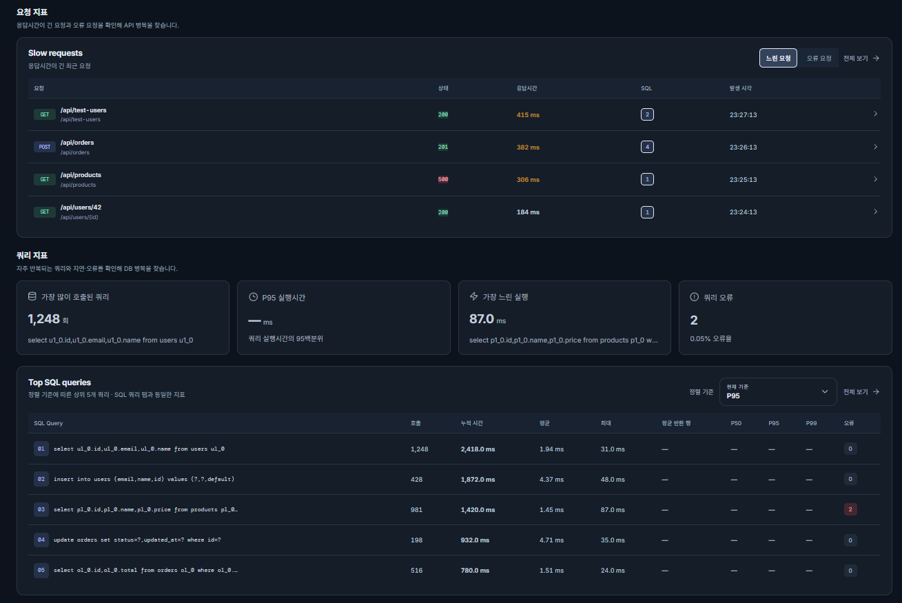
      <sub>개요 대시보드</sub>
    </td>
    <td width="50%" align="center">
      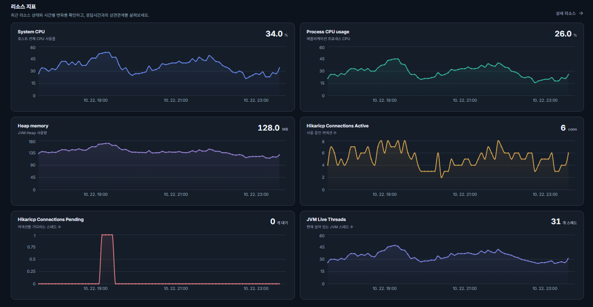
      <sub>서버 리소스</sub>
    </td>
  </tr>
</table>

### 2. 요청 추적

최신 요청, 느린 요청, 오류 요청을 확인하고 요청별 처리 시간과 계층별 실행 시간을 살펴볼 수 있습니다.

<p align="center">
  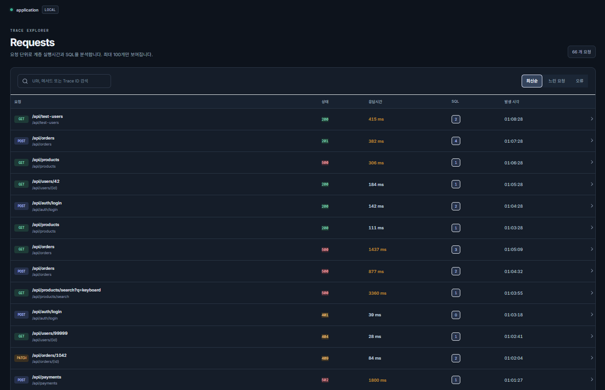
</p>

#### 요청 상세 정보

요청 하나를 선택하면 내부 처리 과정과 개별 SQL 실행 정보를 자세히 확인할 수 있습니다.

<table>
  <tr>
    <td width="50%" align="center">
      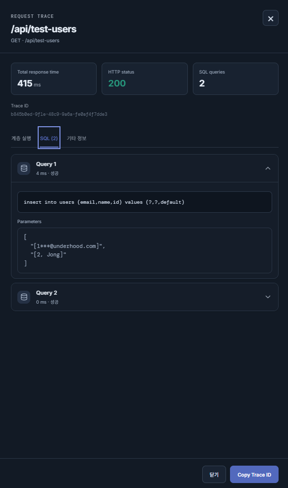
    </td>
    <td width="50%" align="center">
      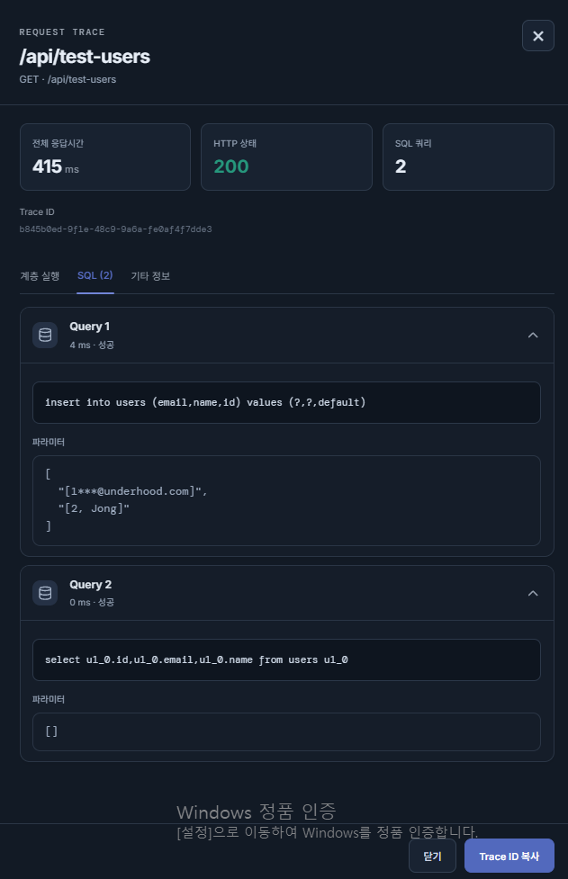
    </td>
  </tr>
</table>

### 3. SQL 분석

쿼리별 실행 통계와 지연 시간 분포를 확인해 성능 저하가 발생하는 SQL을 찾을 수 있습니다.

<p align="center">
  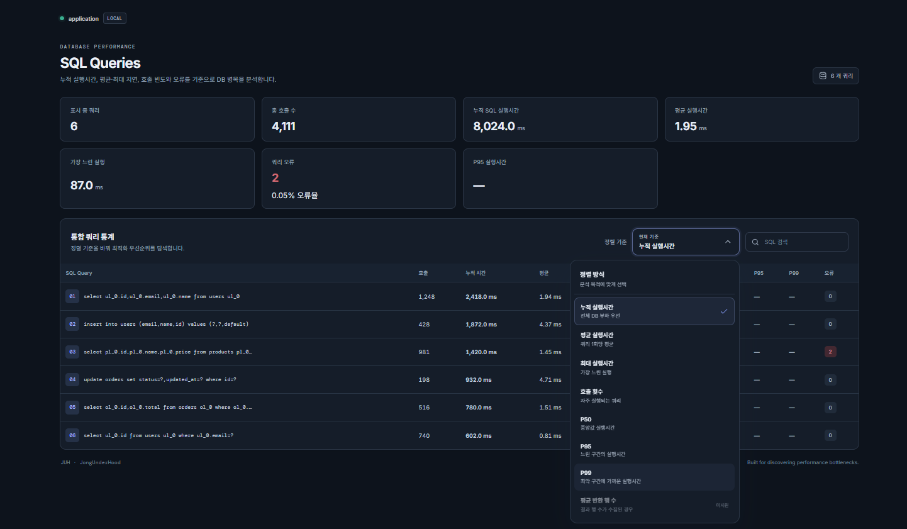
</p>

### 4. 부하테스트 분석

부하테스트를 자동으로 감지하고 테스트별 요청·SQL·리소스 데이터를 연계해 분석할 수 있습니다.

<table>
  <tr>
    <td width="33%" align="center">
      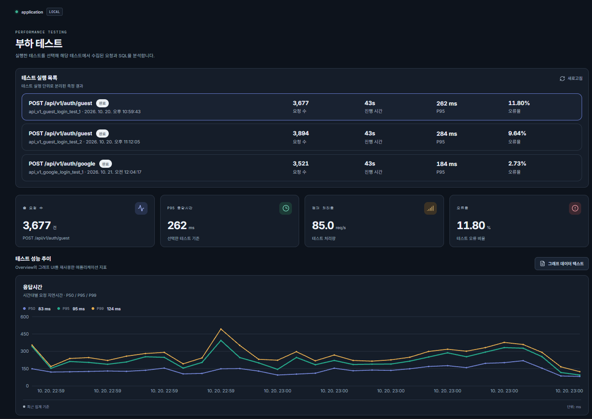
    </td>
    <td width="33%" align="center">
      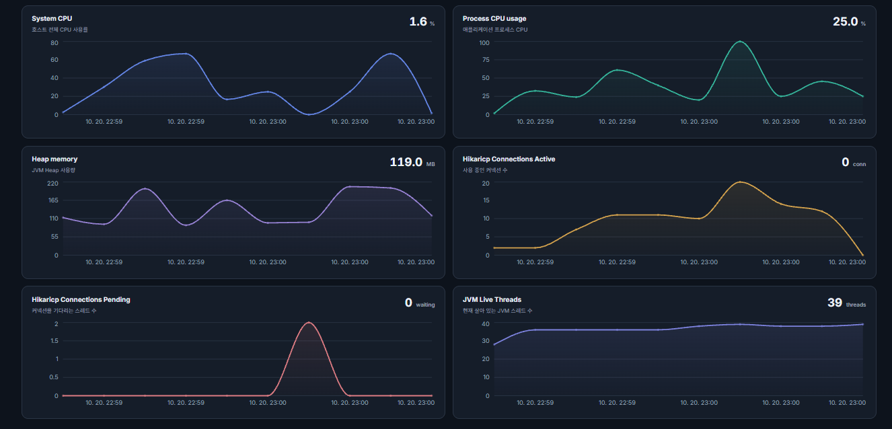
    </td>
    <td width="33%" align="center">
      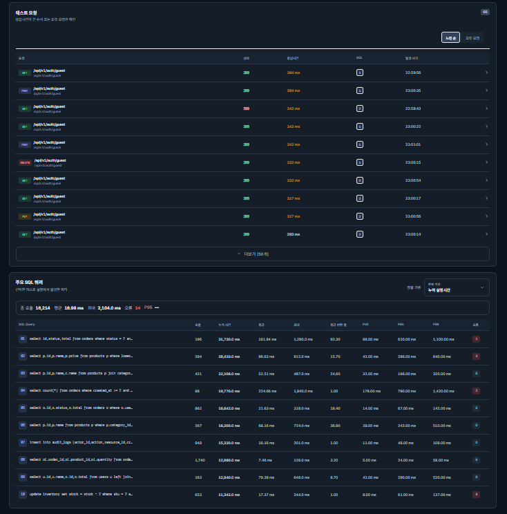
    </td>
  </tr>
</table>

### 5. JUH 자체 리소스

모니터링 도구 자체의 오버헤드를 살펴보고, 큐 포화로 인한 트레이스 드롭 발생 여부를 확인할 수 있습니다. CPU·메모리 값은 추정치이므로 실제 시스템 계측값과 구분해서 해석해야 합니다.

<p align="center">
  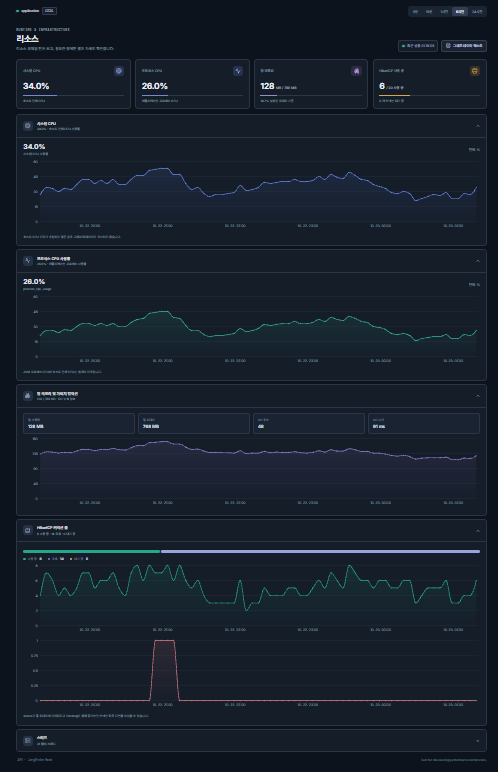
</p>

---

## 데이터 정합성 검증

JUH의 측정값을 애플리케이션 코드의 실측값 및 부하테스트 도구인 k6의 결과와 비교했습니다.

아래 수치는 특정 테스트 환경에서 측정한 결과입니다. 모든 환경에서 동일한 오차가 발생한다는 의미는 아닙니다.

### 1. 애플리케이션 계층별 실행 시간 비교

| 측정 항목 | 코드 실측치 | JUH 측정치 | 오차 | 판정 |
|---|---:|---:|---:|---|
| `findByUserId()` | 144.03 ms | 143.01 ms | -1.02 ms | 약 99.3% 일치 |
| `userRepository.findById()` | 14.59 ms | 13.32 ms | -1.27 ms | 약 91.3% 일치 |
| `refreshTokenRepository.save()` | 8.40 ms | 8.03 ms | -0.37 ms | 약 95.6% 일치 |
| `userEconomyRepository.findById()` | 51.57 ms | 49.13 ms | -2.44 ms | 약 95.3% 일치 |
| Controller 순수 실행 | 392.11 ms | 397.13 ms | +5.02 ms | 약 98.7% 일치 |
| SQL 쿼리 개수 | 4건 | 4건 | 0건 | 100% 일치 |

> 일치율은 코드 실측치를 기준으로 오차의 절댓값을 계산해 비교한 값입니다. 측정 방식이나 실행 환경에 따라 결과는 달라질 수 있습니다.

### 2. 부하테스트 정합성 비교 — k6 vs JUH

에러율을 포함한 과거 테스트 기록

| 측정 항목 | k6 실측치 | JUH 측정치 | 차이 | 해석 |
|---|---:|---:|---:|---|
| 총 요청 수 | 3,951건 | 3,951건 | 0건 | 일치 |
| 성공 요청 수 | 3,470건 | 3,470건 | 0건 | 일치 |
| 실패 요청 수 | 481건 | 481건 | 0건 | 일치 |
| HTTP 실패율 | 12.17% | 12.17% | 약 0.00%p | 일치 |
| 초당 처리량(RPS) | 87.66 | 90.94 | +3.28 | 집계 시간 기준 차이 |
| P50 응답 시간 | 132.36 ms | 126.0 ms | -6.36 ms | 클라이언트 측 지연 등의 영향 가능 |
| P90 응답 시간 | 225.65 ms | — | — | k6 측정값 |
| P95 응답 시간 | 273.16 ms | 260.0 ms | -13.16 ms | 측정 지점 차이의 영향 가능 |
| P99 응답 시간 | — | 381.0 ms | — | JUH 측정값 |
| 최대 응답 시간 | 1,500 ms | 1,498 ms | -2 ms | 유사한 최댓값 |

가장 최신 테스트 기록
| Measurement | k6 | JUH | Difference | Notes |
|---|---:|---:|---:|---|
| Total requests | 3,001 | 3,001 | 0 (0.0%) | Exact match (No trace drop) |
| Successful requests | 3,001 | 3,001 | 0 (0.0%) | Match (100% success rate) |
| Failed requests | 0 | 0 | 0 | Match (Zero error) |
| HTTP error rate | 0.00% | 0.00% | 0.00%p | Match |
| Throughput (RPS) | 99.86 | 101.59 | +1.73 (+1.73%) | Very close (Window timing difference) |
| P50 response time | 618.33 ms | 620.0 ms | +1.67 ms (+0.27%) | Exceptional consistency |
| P95 response time | 1,160.0 ms | 1,200.0 ms | +40.0 ms (+3.45%) | High consistency under bottleneck |
| P99 response time | 1,540.0 ms | 1,600.0 ms | +60.0 ms (+3.90%) | Tail latency accurately tracked |


#### 차이가 발생하는 이유
Spring의 환경에서는 메서드 본문 및 실행 및 쿼리가 기타 다른 오버헤드로 인해 순수 실행 시간보다 길게 측정될 수 있습니다. 기타 다른 APM에서도 동일한 문제를 확인하였습니다.
응답 시간의 경우도 네트워크 왕복 시간(RTT)과 커넥션 연결 오버헤드가 포함되어 약 6~10ms 더 길게 나올 수 있습니다.


### 3. DB 및 SQL 계층 검증

아래는 특정 부하테스트에서 관측한 SQL 실행 건수를 정리한 결과입니다.

| SQL 작업 | 기대 실행 건수 | JUH 수집 건수 | SQL 오류 건수 | 비고 |
|---|---:|---:|---:|---|
| `insert into users` | 3,951건 | 3,951건 | 481건 | 실패 요청과 연관된 오류 |
| `select refresh_tokens` | 3,470건 | 3,470건 | 0건 | 성공 요청 기준 |
| `insert into messages` | 3,470건 | 3,470건 | 0건 | 성공 요청 기준 |
| `insert into refresh_tokens` | 3,470건 | 3,470건 | 0건 | 성공 요청 기준 |
| `select oil_0...` | 3,470건 | 3,470건 | 0건 | 성공 요청 기준 |
| `select users` | 7,902건 | 7,902건 | 0건 | 요청당 2회 실행된 사례 |
| 부가 정보 INSERT 3종 | 각 3,470건 | 각 3,470건 | 0건 | 성공 요청 기준 |
| `insert user_card_items` | 10,410건 | 10,410건 | 0건 | 성공 요청당 3건 |

### 4. 서버 리소스 정합성 (Server Resource Metrics)

| Measurement | k6 (Raw Snapshot) | JUH (Time-Series) | Difference | Notes |
|---|---:|---:|---:|---|
| Peak System CPU | 83.3% | 72.22% | -11.08%p | Smoothed due to 1s periodic sampling |
| Peak Process CPU | 100.0% | 100.0% | 0.0%p | Exact match |
| Peak Heap Memory | 233 MB | 204 MB | -29 MB | Sample timing near GC sawtooth peak |
| Peak HikariCP Active | 20 | 20 | 0 conn (0.0%) | Exact match (Pool limit reached) |
| Peak HikariCP Pending | 79 | 80 | +1 conn (+1.25%) | Near exact match (Bottleneck identified) |
| Peak Active Threads | 38 | 38 | 0 threads (0.0%) | Exact match |

---

## 필독 — 현재 알려진 한계

1. **운영 환경 검증은 계속 진행 중입니다.** 운영 서버의 요청량이 충분하지 않아 다양한 실제 운영 부하를 검증한 데이터가 부족합니다. 로컬 테스트에서는 개요(Overview) 화면에서 약간의 지연이 발생하는 현상을 확인했으며, 개선이 필요한 부분으로 보고 있습니다.
2. **응답 시간은 측정 위치에 따라 달라집니다.** 클라이언트와 서버의 측정값에는 네트워크 왕복 시간(RTT), 연결 설정, 직렬화 등 여러 요소가 다르게 반영될 수 있습니다. 특정 테스트에서 약 6~10ms 차이가 관측될 수 있지만, 이는 고정된 오차가 아니며 환경에 따라 달라집니다.
3. **정합성 수치는 특정 테스트 환경의 결과입니다.** 실제 성능과 오버헤드는 애플리케이션 구조, DB, 요청량, JVM 설정 및 실행 환경에 따라 달라질 수 있습니다.
4. 약 1초 내외의 짧은 Spike 테스트에서는 측정 구간이 짧기 때문에 RPS(초당 요청 수)의 정확도가 떨어질 수 있습니다.
5. 리소스 지표 그래프의 전반적인 추이와 상승·하락 패턴은 실제 데이터와 대체로 유사하게 나타납니다. 다만, **1초 단위로 데이터를 수집하는 과정에서 불가피한 차이가 발생할 수 있습니다.** 
JUH는 **경량 APM을 지향**하므로, 모니터링 오버헤드를 최소화하면서 데이터 정합성을 더욱 개선할 수 있도록 지속적으로 보완할 예정입니다.
6. 현재 JUH는 저장 공간과 리소스 사용량을 최소화하기 위해 **최대 24시간 분량의 모니터링 데이터만 보관**합니다.
이는 **경량화라는 설계 방향**에 따른 것입니다. 향후 실제 사용 사례와 성능 요구사항에 따라 데이터 보관 정책을 개선할 수 있습니다.
---

## 설정

### ▸ 부하테스트 헤더

> 부하테스트를 실행할 때 요청 헤더에 X-JUH-Test-Name을 포함하면 테스트 이름을 직접 지정할 수 있습니다. 예를 들어 X-JUH-Test-Name: Login Load Test로 설정하면 해당 이름으로 테스트를 식별하고 결과를 구분할 수 있습니다.

### ▸  보안 설정 참고
>
> Spring Security를 사용하는 경우, 대시보드 접근을 위해 `requestMatchers`에 `/juh`와 `/juh/` 경로를 모두 추가해야 합니다.
>
> 또한 커스텀 `BlockFilter` 등에서 요청을 차단하고 있다면, 대시보드의 정적 리소스가 정상적으로 로드되도록 `.js`, `.css`, `.html` 파일에 대한 차단 규칙을 확인하고 필요한 경우 제외해야 합니다.
>
> 정적 리소스 요청이 차단되면 대시보드가 정상적으로 표시되지 않을 수 있습니다.


### ▸ 운영 환경 보안 권장사항

>운영 환경에서는 Nginx의 IP 접근 제어를 설정해 `/juh` or `/juh/` 대시보드에 접근할 수 있는 IP를 제한하는 것을 권장합니다. 아래는 허용된 관리자 IP만 접근할 수 있도록 설정하는 예시입니다.

### ▸ Nginx Configuration
```nginx
location ~ ^/juh/?$ {
    # Allowed administrator/office public IP addresses
    allow 211.xxx.xxx.xxx;
    allow 127.0.0.1;

    # Block access from all other IP addresses
    deny all;

    proxy_pass http://localhost:8080;
}
```


### 1. 보안 및 로컬 환경 설정

| 설정 항목 | 기본값 | 설명 |
|---|---|---|
| `juh.security.enabled` | `false` | JUH 대시보드 및 API 보안 활성화 여부. `true`이면 로그인이 활성화됩니다. |
| `juh.security.username` | `admin` | 대시보드 관리자 아이디 |
| `juh.security.password` | `juh_admin_pw` | 대시보드 관리자 비밀번호 |
| `juh.security.local` | `false` | 로컬 환경에서 엔드포인트 기반 자동 부하테스트 감지를 활성화할지 여부 |

**주의:** 위 계정 정보는 기본 예시입니다. 운영 환경에서는 보안을 활성화하고 기본 비밀번호를 반드시 변경하세요.

### 2. 부하테스트 자동 감지 설정

| 설정 항목 | 기본값 | 설명 |
|---|---:|---|
| `idle-timeout-seconds` | `15`초 | 요청이 없을 때 테스트 세션을 종료하기까지 대기하는 시간 |
| `min-requests` | `250` | 일반 부하테스트의 최소 요청 수 |
| `min-rps` | `10.0` | 일반 부하테스트의 최소 평균 초당 요청 수 |
| `soak-min-requests` | `1000` | Soak 테스트의 최소 요청 수 |
| `soak-min-duration-seconds` | `60`초 | Soak 테스트의 최소 지속 시간 |
| `spike-min-requests` | `50` | Spike 테스트의 최소 요청 수 |
| `spike-min-rps` | `50.0` | Spike 테스트의 최소 평균 초당 요청 수 |
| `explicit-min-requests` | `5` | `X-JUH-Test-Name` 헤더로 명시한 테스트의 최소 요청 수 |

### application.yml

```yaml
juh:
  security:
    # true이면 JUH 대시보드 로그인 활성화
    enabled: false

    # 대시보드 관리자 계정
    username: admin
    password: juh_admin_pw

    # 로컬 환경의 자동 부하테스트 감지 여부
    local: false

  load-test:
    # 요청이 없을 때 테스트 세션 종료까지 대기하는 시간(초)
    idle-timeout-seconds: 15

    # 일반 부하테스트 감지 기준
    min-requests: 250
    min-rps: 10.0

    # 장시간 지속되는 부하테스트(Soak Test) 기준
    soak-min-requests: 1000
    soak-min-duration-seconds: 60

    # 짧고 강한 부하테스트(Spike Test) 기준
    spike-min-requests: 50
    spike-min-rps: 50.0

    # X-JUH-Test-Name 헤더로 명시한 테스트의 최소 요청 수
    explicit-min-requests: 5
```

### application.properties

```properties
# ===== JUH Security =====
# true이면 JUH 대시보드 로그인 활성화
juh.security.enabled=false

# 대시보드 관리자 계정
juh.security.username=admin
juh.security.password=juh_admin_pw

# 로컬 환경의 자동 부하테스트 감지 여부
juh.security.local=false

# ===== JUH Load Test Detection =====
# 요청이 없을 때 테스트 세션 종료까지 대기하는 시간(초)
juh.load-test.idle-timeout-seconds=15

# 일반 부하테스트 감지 기준
juh.load-test.min-requests=250
juh.load-test.min-rps=10.0

# 장시간 지속되는 부하테스트(Soak Test) 기준
juh.load-test.soak-min-requests=1000
juh.load-test.soak-min-duration-seconds=60

# 짧고 강한 부하테스트(Spike Test) 기준
juh.load-test.spike-min-requests=50
juh.load-test.spike-min-rps=50.0

# X-JUH-Test-Name 헤더로 명시한 테스트의 최소 요청 수
juh.load-test.explicit-min-requests=5
```

---

**JUH — Lightweight APM for Spring Boot**

요청부터 SQL, 서버 리소스, 부하테스트까지. 여러 화면을 오가는 수고를 줄이고, 성능 문제를 한곳에서 확인해 보세요.
