# JUH — Lightweight Unified Performance Monitoring(APM)
>Requests, SQL, server resources, and load tests — all in one place. Spend less time switching between tools and more time understanding your application's performance.

### How many tools do you need just to monitor your application and run load tests?

Set up Prometheus to collect server metrics. Connect Grafana to visualize them. Configure Zipkin to trace requests. Add another tool to analyze slow SQL queries. And then find yet another way to review load test results…

### Ever spent an entire day setting things up instead of actually monitoring your application?

## Stop adding more tools. Give JUH a try — it's free to use.

**JUH brings request tracing, server resource metrics, SQL statistics, and load test results together in a single dashboard.** It's a lightweight APM built for Spring Boot, designed to make performance monitoring easier to get started with.

<p align="center">
  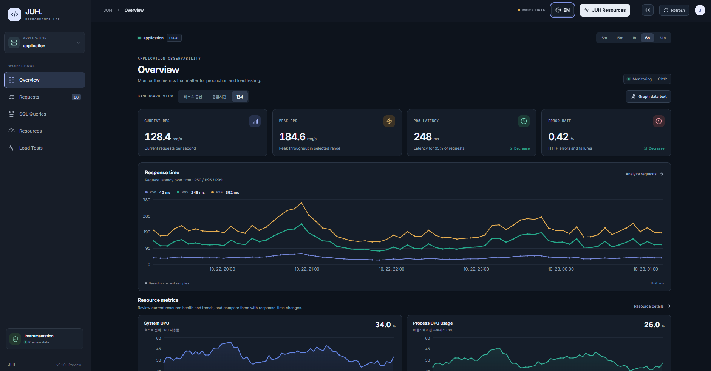
</p>

<p align="center">
  <strong>Unified performance monitoring, starting with a single dependency.</strong>
</p>

- **Live demo:** https://unique-lollipop-9a4948.netlify.app
- **Latest version:** `0.2.0`

Add JUH to your project with Gradle:

```groovy
implementation 'io.github.gangjonggeun:juh-spring-boot-starter:0.2.0'
```
```Kotlin DSL
implementation("io.github.gangjonggeun:juh-spring-boot-starter:0.2.0")
```


> **💡 Accessing the Dashboard**
>
> Append `/juh` or `/juh/` to your application URL to access the dashboard in your browser. Both paths are supported.
>
> - Example (local): `http://localhost:8080/juh` or `http://localhost:8080/juh/` 
> - Example (deployed): `https://example.com/juh` or `https://example.com/juh/`


Prometheus, Grafana, and Zipkin are all excellent tools. But wiring multiple tools together and switching between dashboards can get tedious. That's why I built JUH: to make the most important performance information available in one place.

---


## Features

| Feature | What you can monitor |
|---|---|
| Unified Dashboard | Current and peak throughput (RPS), P95 response time, error rate, response time trends, resource usage, slow and failed requests, and query P95 |
| Request Tracing | Recent, slow, and failed requests; total response time; execution time across Controller, Service, and Repository layers; SQL queries per request; and error details for failed requests |
| Additional Request Details | Cache usage, N+1 risk information, external API calls, and other request metadata |
| SQL Analysis | P50, P95, and P99 query latency; maximum, cumulative, and average execution time; call counts; per-query statistics; and N+1 query detection |
| Server Resources | System and process CPU, heap memory, garbage collection, thread states, and database connection pool status |
| Load Testing | Automatic load test detection, separate results for each test, throughput and latency analysis, error rates, and correlated request, SQL, and resource metrics |
| JUH Overhead | Estimated CPU and memory usage of JUH, plus trace drop events caused by a saturated queue |

---

## Dashboard Preview

### 1. Overview and Resource Monitoring

Get a quick look at application performance and server resource usage from one place.

<table>
  <tr>
    <td width="50%" align="center">
      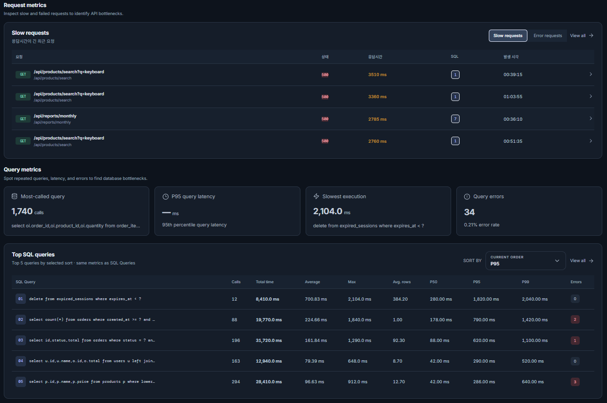
      <sub>Overview</sub>
    </td>
    <td width="50%" align="center">
      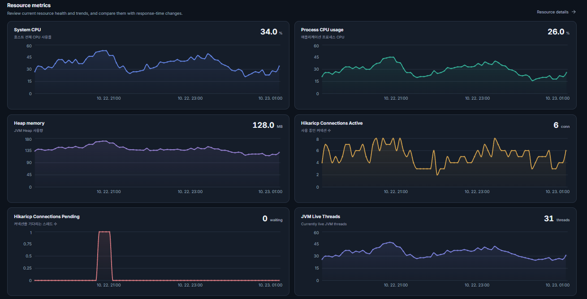
      <sub>Resource Monitoring</sub>
    </td>
  </tr>
</table>

### 2. Request Tracing

Browse recent, slow, and failed requests, then dig into their processing times and individual execution steps.

<p align="center">
  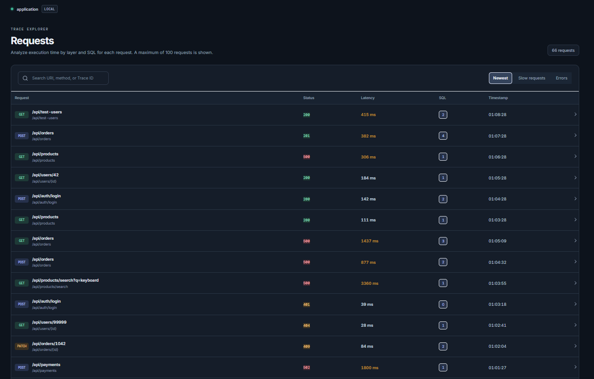
</p>

#### Request Details

Select a request to inspect its processing flow and the SQL queries executed along the way.

<table>
  <tr>
    <td width="50%" align="center">
      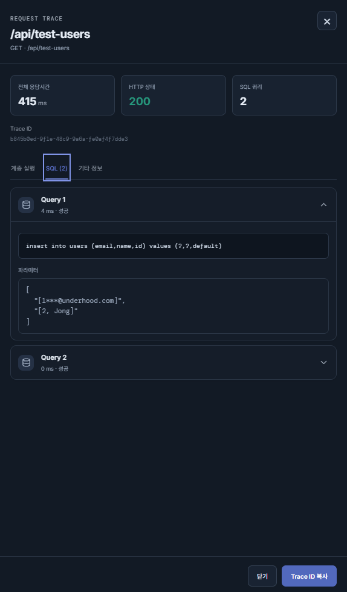
    </td>
    <td width="50%" align="center">
      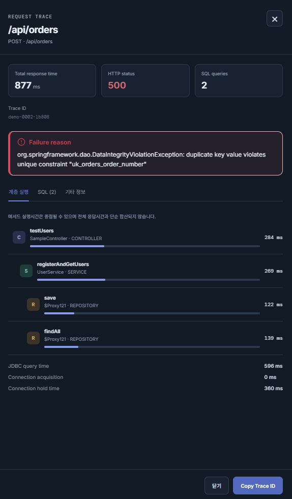
    </td>
  </tr>
</table>

### 3. SQL Analysis

Review query statistics and execution times to help identify SQL queries that may be slowing down your application.

<p align="center">
  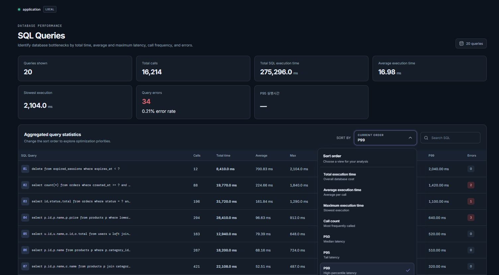
</p>

### 4. Load Test Analysis

JUH can automatically detect load tests and bring request, SQL, and resource metrics together for each test.

<table>
  <tr>
    <td width="33%" align="center">
      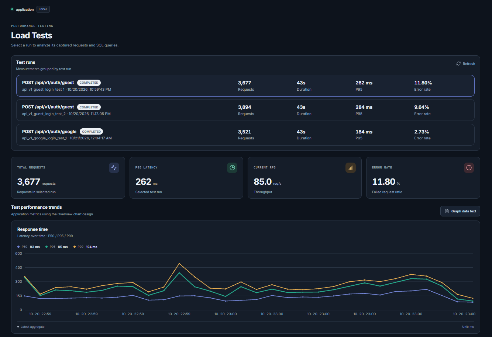
    </td>
    <td width="33%" align="center">
      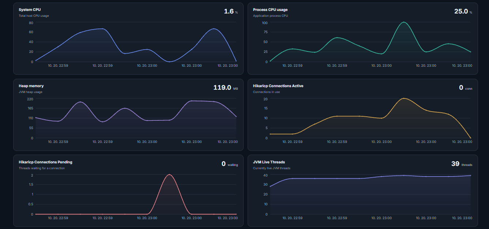
    </td>
    <td width="33%" align="center">
      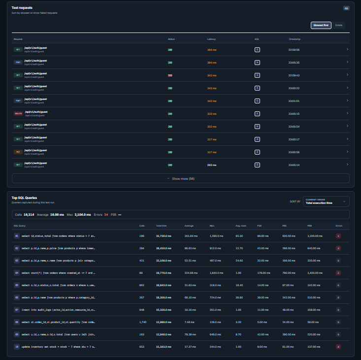
    </td>
  </tr>
</table>

### 5. JUH's Own Resource Usage

Monitor JUH's estimated overhead and check whether trace drops occur when its internal queue becomes saturated. CPU and memory figures are estimates, not direct measurements of all resource usage attributable to JUH.

<p align="center">
  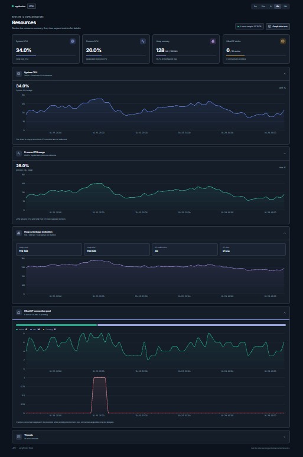
</p>

---

## Measurement Accuracy

JUH's measurements were compared with application-level timings and results from k6, a load testing tool.

The figures below come from a specific test environment. They should be treated as test results, not as guaranteed accuracy levels across all applications or environments.

### 1. Application Layer Timing

| Measurement | Code-Level Timing | JUH Timing | Difference | Result |
|---|---:|---:|---:|---|
| `findByUserId()` | 144.03 ms | 143.01 ms | -1.02 ms | ~99.3% match |
| `userRepository.findById()` | 14.59 ms | 13.32 ms | -1.27 ms | ~91.3% match |
| `refreshTokenRepository.save()` | 8.40 ms | 8.03 ms | -0.37 ms | ~95.6% match |
| `userEconomyRepository.findById()` | 51.57 ms | 49.13 ms | -2.44 ms | ~95.3% match |
| Controller execution time | 392.11 ms | 397.13 ms | +5.02 ms | ~98.7% match |
| SQL query count | 4 | 4 | 0 | Exact match |

> Match percentages are calculated against the code-level timing, using the absolute difference. Results may vary depending on the measurement method and runtime environment.

### 2. Load Test Results — k6 vs. JUH

| Measurement | k6 | JUH | Difference | Notes |
|---|---:|---:|---:|---|
| Total requests | 3,951 | 3,951 | 0 | Match |
| Successful requests | 3,470 | 3,470 | 0 | Match |
| Failed requests | 481 | 481 | 0 | Match |
| HTTP error rate | 12.17% | 12.17% | ~0.00 percentage points | Match |
| Throughput (RPS) | 87.66 | 90.94 | +3.28 | Different measurement windows |
| P50 response time | 132.36 ms | 126.0 ms | -6.36 ms | Client-side latency may contribute |
| P90 response time | 225.65 ms | — | — | Reported by k6 |
| P95 response time | 273.16 ms | 260.0 ms | -13.16 ms | Measurement points may differ |
| P99 response time | — | 381.0 ms | — | Reported by JUH |
| Maximum response time | 1,500 ms | 1,498 ms | -2 ms | Similar maximum values |

### 3. Database and SQL Collection

The following table summarizes SQL execution counts observed during a particular load test.

| SQL operation | Expected count | Collected by JUH | SQL errors | Notes |
|---|---:|---:|---:|---|
| `insert into users` | 3,951 | 3,951 | 481 | Errors associated with failed requests |
| `select refresh_tokens` | 3,470 | 3,470 | 0 | Successful requests |
| `insert into messages` | 3,470 | 3,470 | 0 | Successful requests |
| `insert into refresh_tokens` | 3,470 | 3,470 | 0 | Successful requests |
| `select oil_0...` | 3,470 | 3,470 | 0 | Successful requests |
| `select users` | 7,902 | 7,902 | 0 | Executed twice per request in this test |
| Three additional INSERT operations | 3,470 each | 3,470 each | 0 | Successful requests |
| `insert user_card_items` | 10,410 | 10,410 | 0 | Three inserts per successful request |

---

## Why Timing Differences Occur

In a Spring application, the total time observed can exceed the execution time of the method body or individual queries due to transaction handling and other overhead. The same issue has also been observed with other APM tools.
Response times can also include network round-trip time (RTT) and connection setup overhead, which may add around 6–10 ms in some environments.

---

## Important Notes

1. **Production validation is ongoing.** The production server has not received enough traffic to thoroughly test JUH under a wide range of real-world workloads. Local testing has revealed some delay on the Overview page, and this is an area for improvement.
2. **Response times depend on where they are measured.** Client-side and server-side measurements can differ because of network latency, connection setup, serialization, and other overhead. The 6–10 ms difference mentioned above is an observation from some tests, not a fixed offset.
3. **Accuracy results are environment-specific.** Actual performance and monitoring overhead depend on application architecture, database behavior, request volume, JVM configuration, and the runtime environment.
4. RPS (requests per second) measurements may be less accurate during very short spike tests, especially those lasting around one second, due to the limited measurement window.
---

## Configuration
### ▸ Load Test Header
> You can assign a custom name to a load test by including the X-JUH-Test-Name header in your requests. For example, setting X-JUH-Test-Name: Login Load Test allows JUH to identify the test by name and keep its results organized.

### ▸⚙️ Security Configuration Note

> If you use Spring Security, make sure to include both `/juh` and `/juh/` in your `requestMatchers` configuration to allow access to the dashboard.
>
> If you use a custom `BlockFilter` or similar request-blocking filter, review its rules and exclude `.js`, `.css`, and `.html` files where necessary to ensure the dashboard's static resources load correctly.
>
> Blocking these resources may prevent the dashboard from rendering properly.

### ▸ Production Security Recommendation
>In production environments, it is recommended to restrict access to the `/juh` or `/juh/` dashboard using Nginx IP-based access control. The following example allows access only from explicitly permitted administrator IP addresses.

### ▸ Nginx Configuration

```nginx
location ~ ^/juh(/.*)?$ {
    # Allowed administrator/office public IP addresses
    allow 211.xxx.xxx.xxx;
    allow 127.0.0.1;

    # Block access from all other IP addresses
    deny all;

    proxy_pass http://localhost:8080;
}
```

### 1. Security and Local Environment

| Property | Default | Description |
|---|---|---|
| `juh.security.enabled` | `false` | Enables authentication for the JUH dashboard and API when set to `true`. |
| `juh.security.username` | `admin` | Dashboard administrator username |
| `juh.security.password` | `juh_admin_pw` | Dashboard administrator password |
| `juh.security.local` | `false` | Enables endpoint-based automatic load test detection in a local environment |

**Security note:** These are example defaults. Enable authentication and change the default password before using JUH in a production environment.

### 2. Automatic Load Test Detection

| Property | Default | Description |
|---|---:|---|
| `idle-timeout-seconds` | `15` | Seconds to wait without incoming requests before ending a test session |
| `min-requests` | `250` | Minimum request count for a general load test |
| `min-rps` | `10.0` | Minimum average requests per second for a general load test |
| `soak-min-requests` | `1000` | Minimum request count for a soak test |
| `soak-min-duration-seconds` | `60` | Minimum duration of a soak test, in seconds |
| `spike-min-requests` | `50` | Minimum request count for a spike test |
| `spike-min-rps` | `50.0` | Minimum average requests per second for a spike test |
| `explicit-min-requests` | `5` | Minimum request count for a test identified with the `X-JUH-Test-Name` header |

### application.yml

```yaml
juh:
  security:
    # Enable dashboard authentication when true
    enabled: false

    # Dashboard administrator credentials
    username: admin
    password: juh_admin_pw

    # Enable automatic load test detection in local environments
    local: false

  load-test:
    # Seconds without incoming requests before ending a test session
    idle-timeout-seconds: 15

    # General load test detection thresholds
    min-requests: 250
    min-rps: 10.0

    # Soak test thresholds
    soak-min-requests: 1000
    soak-min-duration-seconds: 60

    # Spike test thresholds
    spike-min-requests: 50
    spike-min-rps: 50.0

    # Minimum requests for tests identified by X-JUH-Test-Name
    explicit-min-requests: 5
```

### application.properties

```properties
# ===== JUH Security =====
# Enable dashboard authentication when true
juh.security.enabled=false

# Dashboard administrator credentials
juh.security.username=admin
juh.security.password=juh_admin_pw

# Enable automatic load test detection in local environments
juh.security.local=false

# ===== JUH Load Test Detection =====
# Seconds without incoming requests before ending a test session
juh.load-test.idle-timeout-seconds=15

# General load test detection thresholds
juh.load-test.min-requests=250
juh.load-test.min-rps=10.0

# Soak test thresholds
juh.load-test.soak-min-requests=1000
juh.load-test.soak-min-duration-seconds=60

# Spike test thresholds
juh.load-test.spike-min-requests=50
juh.load-test.spike-min-rps=50.0

# Minimum requests for tests identified by X-JUH-Test-Name
juh.load-test.explicit-min-requests=5
```

---

**JUH — Lightweight APM for Spring Boot**

Requests, SQL, server resources, and load tests — all in one place. Spend less time switching between tools and more time understanding your application's performance.
